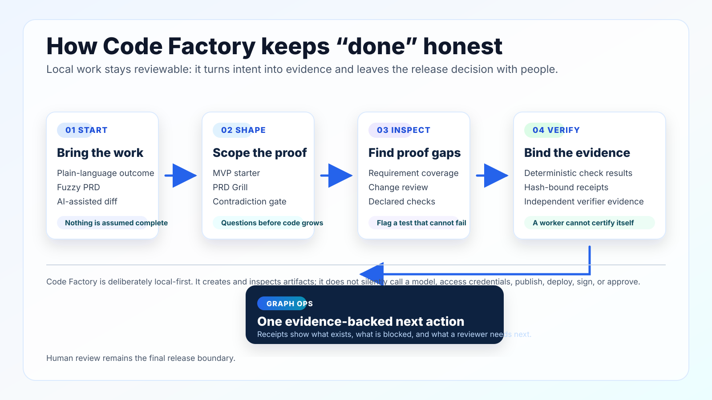
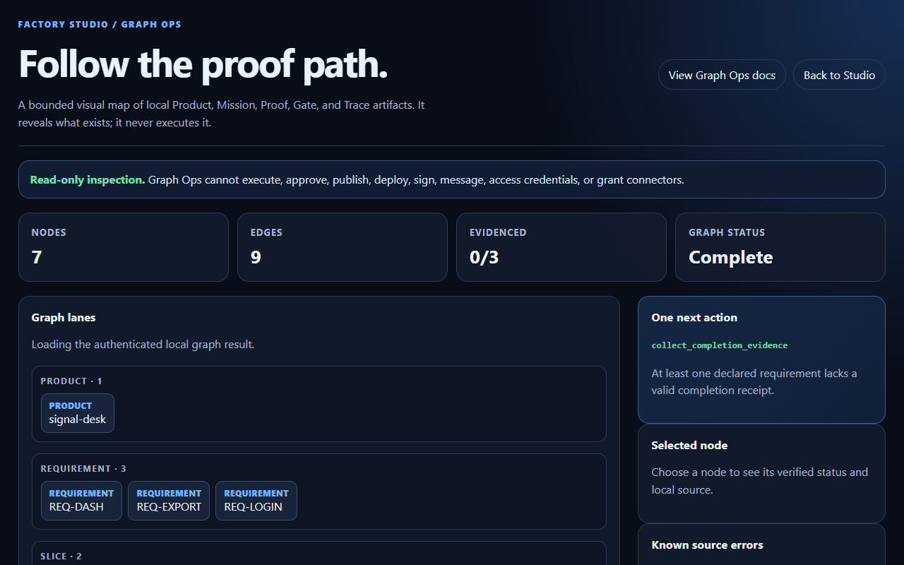

# Code Factory

**Your AI writes the change. Code Factory shows what was actually checked.**
Review agent-written code by collecting local software review evidence:
trace findings to their source, challenge weak tests, and keep the release
decision with your team. Code Factory does not certify software.

**Code Factory 0.50.0**

[Release downloads](https://github.com/zrk222/code-factory/releases/tag/v0.50.0) ·
[Release channels](docs/RELEASE_CHANNELS.md) ·
[Quick guide](docs/START_HERE.md) · [Package licensing](docs/commercial-model.md) ·
[Screenshots](#product-walkthrough)

```powershell
python -m pip install factoryline-code-factory==0.50.0
factory scan --root . --static-only
```

The core runs on Python 3.10+. The full `[factory]` install requires Python 3.11+.

The default static scan analyzes Python. Other native analysis requires
[configured workers](docs/START_HERE.md). A scan can exit 0 with status
`INCOMPLETE`. Check that status and the audited file count before relying on it.

## What changed in 0.50.0

Current coverage adds Go, Java, C# and Ruby framework sources/sinks plus wider
Ruby/Swift trust checks. New request coverage is review-tier. Round 7 numbers
below belong to the earlier ruleset, not a fresh score for the shipped variant.
[Coverage evidence and limits](docs/evidence/polyglot-coverage-round8.json).

**New in this release:** retrieve trusted evidence across topics without loading
the whole history, check visible behavior against approved pixels and Prestige
tokens, and operate a foreground coordinator with signed fresh-worker handoffs.
Missing evidence stays visible; your team retains the release decision.
The newer advisory study records CodeQL detections in **15/91 analyzed cases**,
with **70/161 not executed**. Pattern replay found **6/161 on exposed cases**;
the lanes are not interchangeable and neither number is whole-CF blind recall.
[Inspect the lane-separated record](docs/evidence/advisory-recall-factory-20261121.json).

- **12 languages, one review workflow:** the configured native security worker
  covers C, C++, C#, Go, Java, JavaScript, PHP, Python, Ruby, Rust, Swift and
  TypeScript. Thirty rules separate default findings from review-only context;
  worker setup and coverage gaps remain explicit.
- **Measured strengths and gaps:** the fresh Round 7 default tier supported
  **38/40 decided alerts (95%; Wilson 83.5–98.6%)**, with **12 additional unclear**.
  Review tier supported **23/40 (57.5%)**, with 3 unclear. Advisory recall was
  **0/161**; six languages had fewer than five decided alerts. AI labels and
  per-language denominators are disclosed—not twelve-language accuracy or
  independent human validation. [Inspect readiness](docs/evidence/polyglot-readiness-round7.json).
- **Fits the tools you already use:** frozen JSON output, SARIF 2.1.0, opt-in
  pre-commit, source-bound GitHub proof handoffs and an eight-tool read-only
  Devin MCP profile put evidence beside agent suggestions.
- **Review the exact change:** signed-observation `verify_claim`, a bounded
  owner-approved Proof Agent and byte-exact mutation diffs show what was checked,
  what is missing and what to do next. Neither agents nor receipts self-approve.
- **Check visible behavior too:** an optional, explicitly admitted local-browser
  gate compares reviewed pixels, accessible control identity, terminal UI state
  and correlated API responses. Prestige token checks and token-removal
  challenges use the same source-bound receipt. Missing tooling or evidence
  stays incomplete; this is not a native-device or release certificate.

[Changes and fixes](CHANGELOG.md#0500--2026-11-22) ·
[Panel results and limits](https://github.com/zrk222/code-factory/pull/354) ·
[Native worker controls](https://github.com/zrk222/code-factory/actions/runs/44893613016)

| What you need | Command |
| --- | --- |
| Quick Python source review | `factory scan --root . --static-only` |
| Deeper review with available evidence | `factory scan --root .` |
| Visual review workspace | `factory studio --root .` |

Review the findings, repair the code, and rerun your tests and affected checks.
Quick scan reads Python source without running your project. Deep scan adds
applicable evidence lanes and shows what was unmeasured. Native analysis for
JavaScript, shell, and other languages needs configured workers. A clean static
scan does not establish runtime coverage. Missing evidence stays **INCOMPLETE**.

`factory --help` shows the common paths; `factory --help-all` lists the full CLI.
`factory guide` helps you choose the next step.
The [quick guide](docs/START_HERE.md) explains scan results and CI options.

## Build, check, review

**[SpecLine](https://github.com/zrk222/code-factory-1-spec)** captures what needs
to be true, **[ForgeLine](https://github.com/zrk222/code-factory-2-forge)**
coordinates execution, and **FactoryLine** records the proof and next action.
**HSF** (Harness Software Factory) compiles selected rules into repeatable logic.
**Prestige** checks design where applicable. **AppForge** handles app and mobile
delivery inside Code Factory.
Core 0.50.0 connects these steps in a resumable local mission with recorded
recovery and resource-aware checks.
[Install the full toolchain](docs/START_HERE.md#install-the-full-toolchain) or see
the [proof workflow](docs/PROOF_REVIEW_WORKFLOW.md).



## Product walkthrough



<details>
<summary>Four annotated screenshots from the 0.49.6 preview</summary>


The fictional workspace contains a planted finding. Its scan has complete source
coverage and incomplete overall evidence.

</details>

<details>
<summary>Historical precision measurement: N443-38 exposed replay</summary>

On the same observed cases, decided actionable precision was **88.24% (30/34)**
versus 85.71%; 37 of 38 cases returned and all 30 original true positives were
retained. The original sealed first pass was 83.33% on decided labels (30/36)
and 78.95% counting all 38 selected cases. Two blind AI reviewers supplied the
labels. [Case ledger](https://github.com/zrk222/code-factory/releases/download/v0.49.6/original38-regression-0.49.6.json)

</details>

## Reference

[Runtime assurance](docs/RUNTIME_ASSURANCE.md) ·
[GitHub review](docs/GITHUB_PROOF_REVIEW.md) ·
[Release channels and publication evidence](docs/RELEASE_CHANNELS.md) ·
[Changelog](CHANGELOG.md) ·
[Audit condition inventory](docs/AUDIT_CONDITION_INVENTORY.md) ·
Historical [repository self-audit receipt](evidence/self-audit/quality-reassessment-2026-10-04.json) ·
[Commercial availability](docs/COMMERCIAL_PACKAGING.md) ·
[Documentation index](docs/DOCUMENTATION_INDEX.json)

If Code Factory helps you, a GitHub star helps others find it.

<!-- mcp-name: io.github.zrk222/code-factory -->
