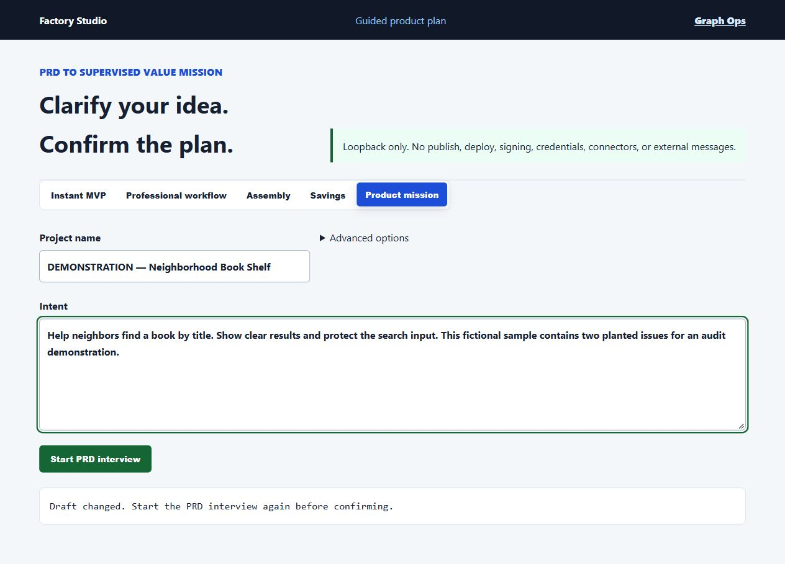
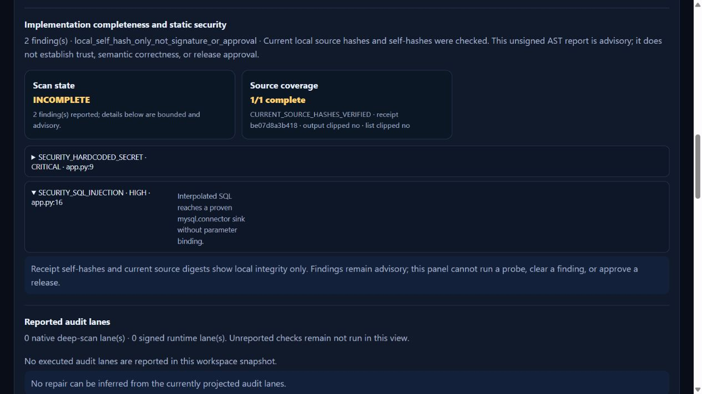
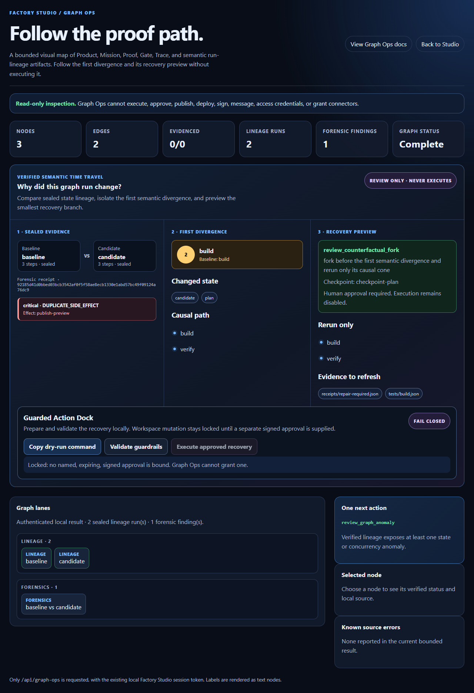
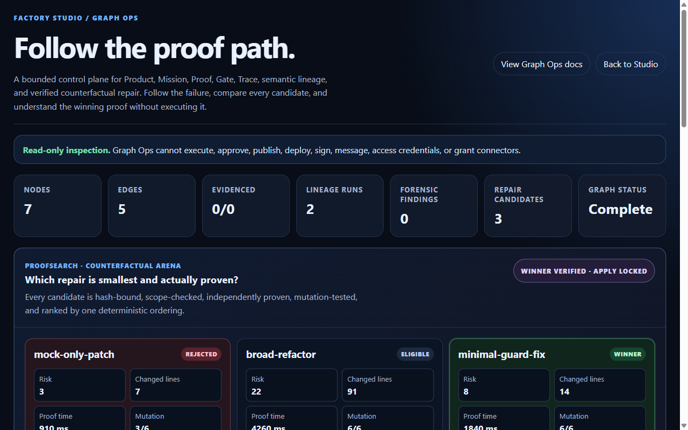
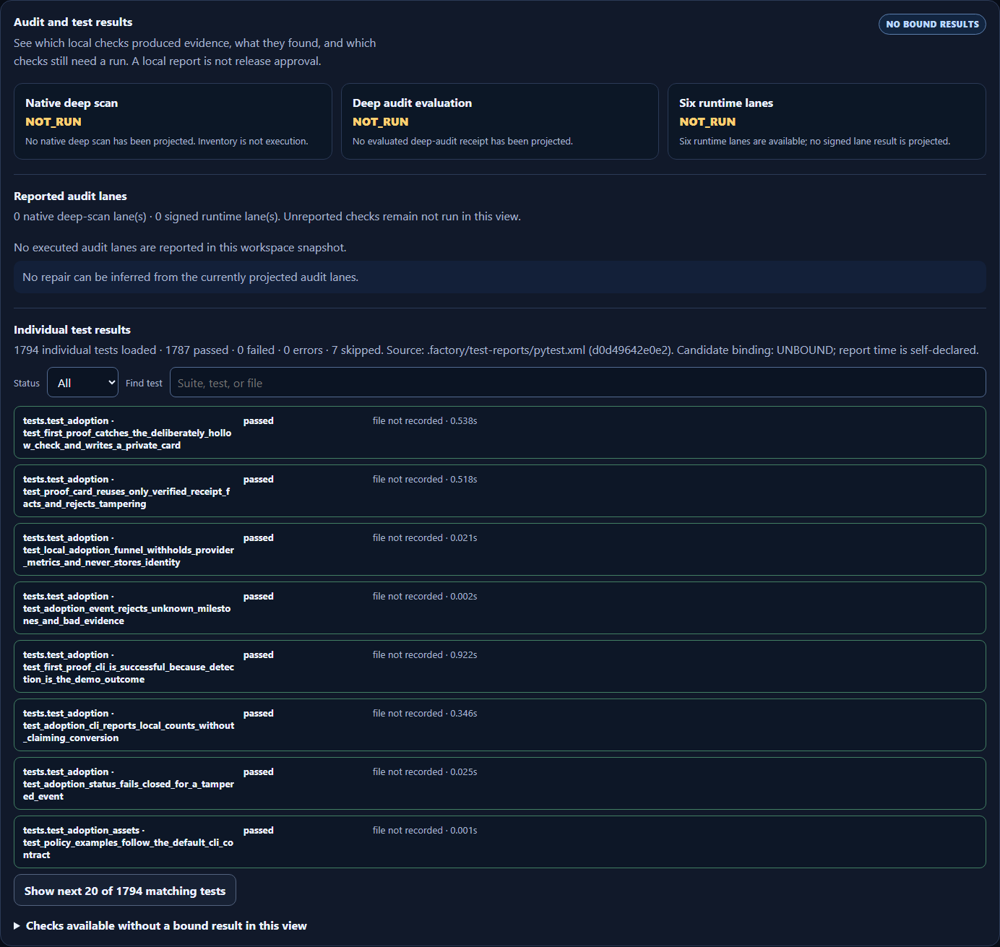
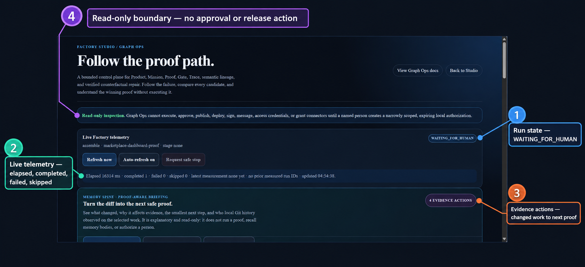

# Code Factory

Your agent built it. Your review service reviewed it. Code Factory helps you
inspect what was checked, what failed, and what still needs evidence before
you accept the change. Start with one command:

```powershell
python -m pip install factoryline-code-factory
factory scan --root .
```

**Your workflow:** scan → review the findings → repair → run your tests and the
affected checks again. The basic scan reads eligible Python source; it does not
run your project. Missing evidence is **INCOMPLETE**, not a clean bill of health.

## Current source preview — core 0.48.2, VS Code 1.2.1, JetBrains 1.2.0

The bounded security review follows values through supported local helpers to
HTTP, file, and SQL sinks, and checks an upload directory separately from its
sanitized filename. Studio surfaces a shared next action; optional JEV
integration remains advisory; unavailable evaluations stay incomplete. These changes are not a claim of
exhaustive analysis or measured detection accuracy. Review findings, run the
affected checks, and decide what to accept before using a repair.

Want a visual workspace? Run `factory studio --root .`. Need options?
`factory --help` shows the short path; `factory --help-all` shows all commands.
Start with [the quick guide](docs/START_HERE.md).

Keep pytest, mutation testing, CodeQL, Semgrep and your review checklist. CF adds
test-quality findings and source-bound local evidence alongside them. A basic
scan needs no adoption ceremony, signing keys, tenant setup or Docker. Native
worker execution has separate setup and safety requirements.

Code Factory is the product. Its internal engines and advanced governance
features are optional workflows, not prerequisites for reviewing your code.

## Starting from an idea?

Describe your idea to your coding agent and create `PRD.md`. The optional
[beginner guide](docs/PRD_GRILL.md) helps turn it into concrete acceptance checks.
For an existing repository, start with the scan above.

## From an idea to a reviewable change

For a new builder, start with an idea and make the expected behavior concrete.
For an experienced developer, start with the repository or proposed diff.
SpecLine helps structure requirements; ForgeLine adds architecture and test-intent
checks; Code Factory connects the findings, evidence and next action. The basic
scan does not require those optional workflows.



Then inspect the findings, repair the code, and rerun the affected checks. Keep
your coding agent and review services, including CodeRabbit, Devin or Blitzy.
CF adds its combination of test-intent checks, optional runtime mutation
evidence and local receipts bound to source. Review services also offer testing
and analysis; CF's evidence helps you inspect the work alongside them.



**Demonstration, October 16, 2026:** the installed local CF runtime scanned one
fictional Python file and reported two planted security findings. Studio shows
1/1 source files assessed and incomplete evidence. These are real sample-run
observations, not an accuracy benchmark, a JetBrains IDE capture or a release
approval. Unrun runtime lanes remain visible as not run.

Try the free local core on your own repository. If it helps, a GitHub star makes
it easier to discover; fork it to improve a rule or contribute a reproducible
positive and negative example. Reports of missed issues and false alarms are
useful contributions too.


Code Factory + ForgeLine (CF/FL) is a robust, local-first code-audit factory.
It starts by collecting local software review evidence for the candidate change.
It connects requirements, architecture checks, Python AST security analysis,
behavioral test evidence, workflow integrity, specialty AI review, and
actionable repair. Its receipts support review; the tool does not certify
software, guarantee that defects are absent, or approve a release.

**Product naming:** Code Factory is the product and ForgeLine is its audit and
architecture engine. SpecLine, HSF, and Prestige are advanced internal lanes
that appear only when a project declares the corresponding scope; they are not
separate products a new user must learn before running a scan.

## Graph Ops in action



This full-page local capture shows Graph Ops tracing a change from sealed
lineage through a forensic finding to a proposed recovery path. The guarded
action remains locked; the dashboard is a read-only inspection surface.



The Counterfactual Arena compares repair candidates and shows their evidence
and risk. [Winner controls](docs/assets/marketplace/graph-ops-proofsearch-controls.png)
and the [Evidence Frontier](docs/assets/marketplace/graph-ops-evidence-frontier.png)
show how a reviewer can inspect the rationale and choose the next proof.

The current Graph Ops UI also separates native deep-scan progress, evaluated
deep-audit receipts, six runtime lanes, and individual JUnit test cases. Each
panel labels its evidence state and next repair. Filter or search the recorded
tests, then load more cases as needed; an inventory or a missing report never
appears as a passing run. The JUnit reader accepts up to 10,000 cases and marks
larger or malformed reports incomplete. A JUnit report is local observation
without a current-candidate binding.



This local UI capture shows each reported test case with its status. The audit
cards keep checks without a bound result explicitly marked not run.

<details>
<summary>Supplement: annotated live Assembly telemetry</summary>



The labels explain an [original local Assembly capture](docs/assets/marketplace/factoryline-0.44-live-dashboard.png).
That pictured run is waiting for human input; it does not imply release approval
or that every check passed.

</details>

## Add deeper audit lanes

```powershell
factory scan --root . --deep
```

Deep mode orchestrates architecture, Python security and test-oracle checks,
workflow integrity, requirements, runtime coverage, and dependency evidence.
Languages including TypeScript/JSX, Go, Rust, Java, C/C++, C#, Ruby, PHP and
Swift are inventoried explicitly; missing native analysis remains unmeasured.

For authorized native execution, use:

```powershell
factory scan --root . --deep --worker-config .factory/worker-config.json --json
```

The configuration contains workspace-relative `manifest`, `authorization`, and
`trust_root` paths plus `manifest_sha256` and `trust_root_sha256` pins. This
invokes the existing signed Docker worker engine for configured CodeQL,
Semgrep, secrets, dependency, container, runtime and fuzz lanes. Unsigned plans
are rejected. Completed workers still require independent agent review;
missing evidence and review cannot produce a passing verdict. Native execution
requires its configured images and tooling and can take longer than a minute.
Each unresolved lane includes its next action. Receipt presence alone is not
verification, and no scan claims to detect every defect.

Package metadata now uses **Production/Stable**, starting with this source
update. That release-status label is separate from detection accuracy,
independent benchmark results, and provider publication.

In an interactive terminal, `factory` optionally makes one plain PyPI version
check and caches the result for up to 24 hours, then prints a notice when a
newer version is available. It never downloads or installs the update. The
check is quiet in CI, JSON output, server/MCP, help, version, and
non-interactive runs; set `FACTORY_DISABLE_UPDATE_CHECK=1` to turn it off. The
optional request does not include a project path, account identifier, or usage
data. All audit and proof commands remain local unless an operator explicitly
uses a separate provider integration.

Run repository commands from the project being reviewed. `factory guide` is a
read-only orientation; it does not run tests or agents.

## Inspect this repository

These commands show the current architecture policy, the bounded static
security scan, and the runtime-audit setup:

```powershell
factory architecture health --root . --json
factory audit security --root . --json
factory runtime-audit status --root . --json
```

`factory audit security` checks a limited set of source patterns. It is not a
penetration test. The runtime audit needs a separately reviewed plan and its
own environment evidence. A status of `NOT_RUN` or a clean static scan is not a
complete project audit.

To display individual tests in Graph Ops, run your suite with a JUnit report at
`.factory/test-reports/pytest.xml` (for example,
`python -m pytest --junitxml=.factory/test-reports/pytest.xml`). The local
Studio reads the report and labels its candidate binding `UNBOUND`; it does
not infer that those results still apply after source changes.

The prior snapshot's [repository self-audit receipt](evidence/self-audit/quality-reassessment-2026-10-04.json)
records **A (97.9/100)** and 1,055/1,085 functions attributed to test intent
(97.24%). That static measurement applies to its recorded source digest and is
superseded for this candidate by the clean tracked-snapshot result above; it is
not runtime coverage or certification.

ForgeLine 0.10.8 computes Python complexity for public module functions and
public class methods in its recorded `metrics.scope.code_files`; names starting
with `_` are excluded. Its AST metric counts branches, boolean alternatives,
exception handlers, `with`, and assertions. Ruff C901 uses a different McCabe
metric and also checks private functions. CI therefore runs
`python -m ruff check --select C901 factoryline tests` separately at limit 10.
The ForgeLine maximum must not be read as the maximum of every Python function.
CI also checks action and reusable workflow references for immutable commit
pins; the generic workflow evidence validator alone does not inspect those refs.
<!-- mcp-name: io.github.zrk222/code-factory -->

## Release controls

Candidate preflight requires release-cadence admission and strict architecture
health. Protected main requires CI and a separate specialty AI source review;
the coordinator records that assessment, separately from test evidence. It is
not a second human approval. Provider publication and marketplace approval are
separate outcomes. See [release channels](docs/RELEASE_CHANNELS.md).

Architecture health checks growth budgets. ForgeLine's repository inventory
and feature QA are separate checks. The [current gap review](docs/AUTONOMOUS_OPS_EDITOR_PLAN.md)
records historical parser behavior; the current candidate's pinned-parser result
is listed above. CF requires ForgeLine 0.10.8 and checks real MJS, TS, and TSX
feature QA during `factory doctor --strict`. Static signals are neither
executed coverage nor a security certification.

## More detail

- [Engineering review workflow](docs/PROOF_REVIEW_WORKFLOW.md)
- [GitHub Proof Review](docs/GITHUB_PROOF_REVIEW.md)
- [Commercial availability and limits](docs/COMMERCIAL_PACKAGING.md)
- [Audit condition inventory](docs/AUDIT_CONDITION_INVENTORY.md)
- [Runtime assurance limits](docs/RUNTIME_ASSURANCE.md)
- [Release channels and publication evidence](docs/RELEASE_CHANNELS.md)
- [Changelog](CHANGELOG.md)
- [Documentation index](docs/DOCUMENTATION_INDEX.json)

## Updated video preview

[60-second CF/FL audit and repair walkthrough](https://youtu.be/covWDYhUqbM) — October 8, 2026. Silent captions, current Graph Ops captures, bounded scanner improvements and agent repair evidence requirements. The source render is in `videos/code-factory-proof-of-survival/remotion`.

## Native agent-harness preview — current source candidate

Status: Current source preview only; published Code Factory 0.48.1 remains unchanged. Local-wheel inclusion is not claimed.

The native harness keeps incident checkpoints for recovery, binds review
context shards to source, and compares candidate repairs without applying them.
Budgeted Jev triage keeps unprocessed incidents visible as pending, not assessed.
Parallel audits are opt-in and require a signed policy declaring work
non-mutating and resource-safe; serial remains the default, and the declaration
does not prove isolation. Optional activation experiments call only hooks
explicitly registered by the caller. Their observations are experimental, not
model certification or accuracy evidence. The source taxonomy and manifest define the same routes for
Junie while keeping execution and identity limits visible.

## Native scanner expansion — core 0.48.2 / editor 1.2.0 source preview

**Fixed:** native scanner controls require vulnerable and safe results bound to
image, profile and source hashes. Missing evidence remains incomplete.
Test-intent auditing recognizes argument/await assertions, expected-exception
failure checks and invoked local assertion helpers. Direct local serialization
round-trips in tests retain informational findings and custom-reducer warnings.
**Changed:** agents use one `factory scan --deep` overview and explicitly
configured native workers selected for the project's languages and risks.
JavaScript/Actions workers verify bundled compiled queries rather than rebuilding
them, and receipt discovery skips explicit file checks for unrelated logs.
**Added:** CodeQL JavaScript/TypeScript interprocedural analysis, GitHub Actions
security-extended analysis, and ten Python/JavaScript/TypeScript Semgrep
rules including local taint tracking. CodeQL controls require native flow
evidence; Semgrep community output does not establish cross-file coverage.
The external-source regression corpus now includes 31 upstream cases from
requests, Rich and Click; it is separate from the eight seeded benchmark cases
and does not establish held-out accuracy.

Code Factory is a robust code audit factory with Production/Stable package
metadata. This source preview does not establish new marketplace publication,
runtime verification of every repository, or measured detection accuracy.

## Smaller models, stronger quality workflows

CF/FL is designed to guide smaller LLMs toward frontier-like coding performance
through deterministic workflows, independent audits and evidence-driven repair.
Sealed task packets keep requirements, scope and acceptance checks explicit.
This is the design objective; model parity and cost savings require a paired
benchmark and are not established by the current attribution metric.
