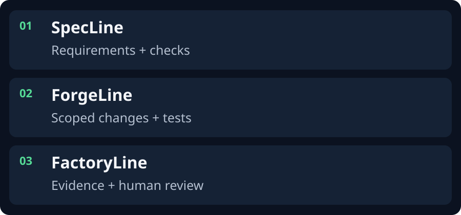

# Code Factory

Code Factory helps you plan, build, improve and review software. Turn requirements into scoped work, generate an app foundation, and check code, security, tests, design and runtime behavior. Collect evidence for team review, CI, mobile releases and monetization. Missing checks stay visible. You decide what ships.

## Choose your starting point

- **Build or extend a product:** [Product Missions](PRODUCT_MISSIONS.md) for requirements and work slices; [App Builder](APP_BUILDER.md) for a starter app.
- **Audit a project:** [install and run](START_HERE.md) `factory scan --root .`. Add `--static-only` for a quick Python source review.
- **Review AI-written changes:** use [Proof Review](PROOF_REVIEW_WORKFLOW.md), then inspect with `factory studio --root .` or [GitHub checks](GITHUB_PROOF_REVIEW.md).
- **Check design or behavior:** use [Prestige design review](PRESTIGE_DESIGN.md) or configure [runtime checks](RUNTIME_ASSURANCE.md).
- **Prepare a mobile release:** use [AppForge release evidence](APPFORGE_SUBMISSION_ASSURANCE.md) and [RevenueForge monetization checks](REVENUEFORGE.md). These don't submit to stores.

## Example: WMM, built with Code Factory

[▶ Watch the WMM story · 57 seconds · sound](https://zrk222.github.io/code-factory/deploy/huggingface/cf-story-v5-narrated.mp4)

*Example data. Illustrated process.*

[Start here](START_HERE.md)